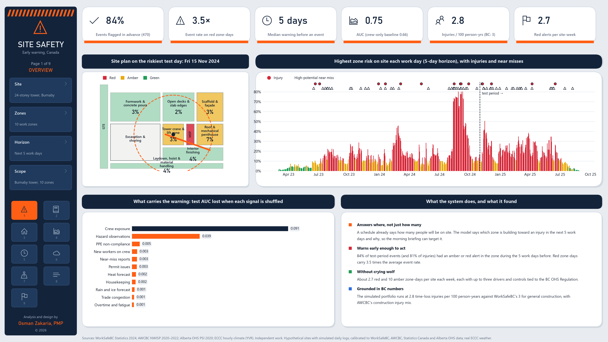
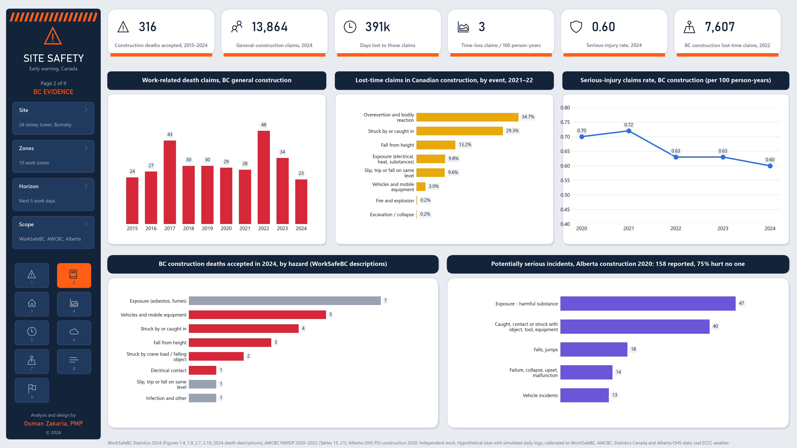
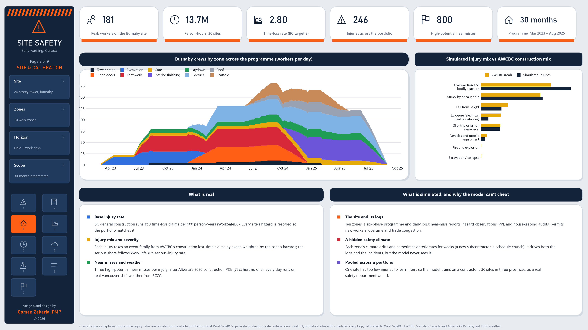
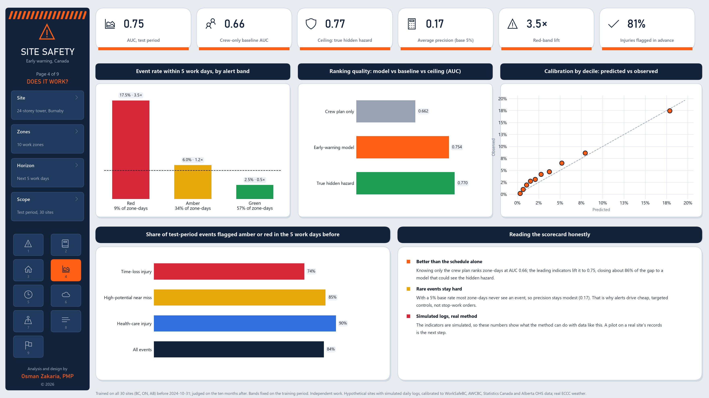
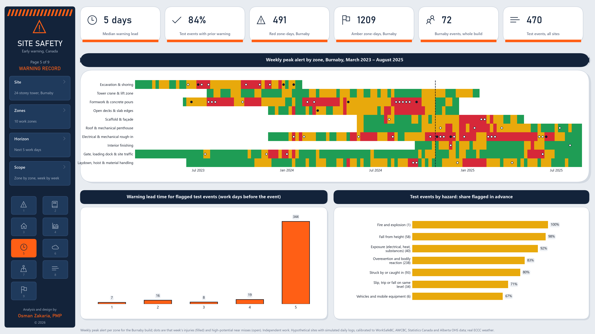
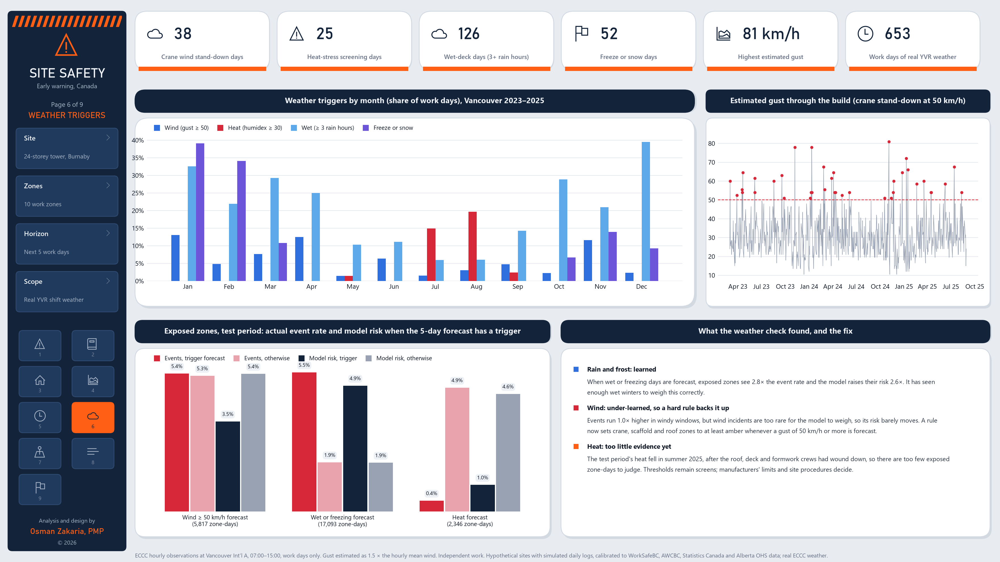
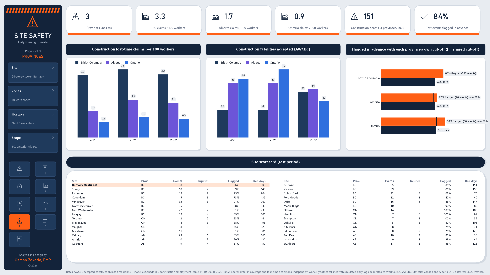
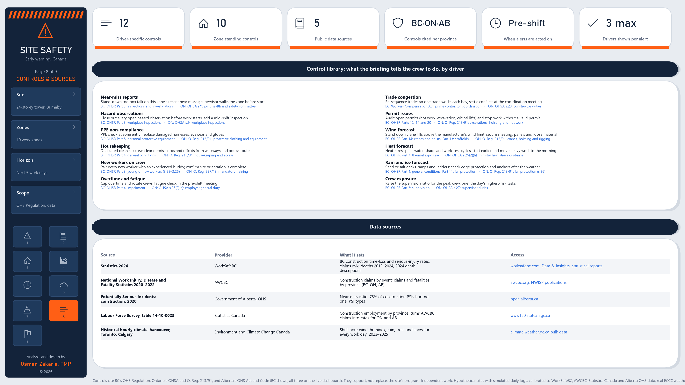
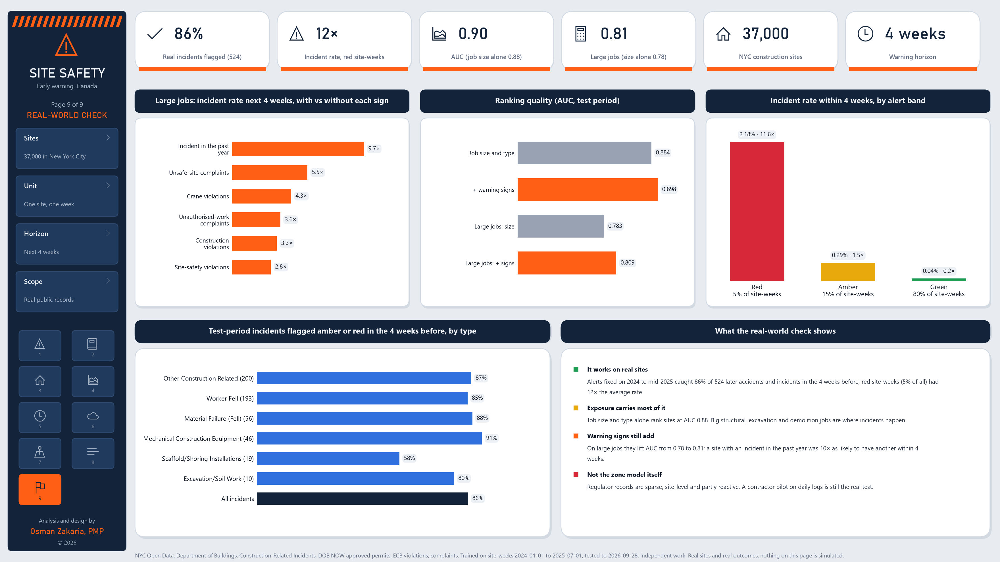

# Site Safety Early Warning

**Which zone of a construction site is most likely to hurt someone in the next five work days, the warning signs behind it, and the controls to put in place before the shift.**

A superintendent already knows how many people will be on site tomorrow. This system says *where* the next injury is building up. For each of ten work zones it scores, every work day, the risk of an injury or high-potential near miss in the next five work days. It names the warning signs driving that risk (near-miss reports, hazard observations, housekeeping, fatigue, trade congestion, the weather forecast) and turns them into controls cited for the site's province. It runs on a contractor's portfolio of 30 sites in **British Columbia, Ontario and Alberta**, each calibrated to its province's construction injury rate and run on its province's **real weather**. The live dashboard re-scores as a site logs each day, reads **site photos** for hazards, scores a company's **own uploaded logs**, and is checked against **real incidents** in New York City's public records.

[](https://claude.ai/artifact/7YTTA3WRJAfJstwjaZGdb6)
[](#run-it)
[](#the-dashboards)
[](#data-sources)

Analysis and design by Osman Zakaria, PMP. **Independent work**: not produced by, affiliated with or endorsed by WorkSafeBC, the WSIB, Ontario's Ministry of Labour, Immigration, Training and Skills Development, Alberta OHS or any employer. A decision-support prototype; it supports, and never replaces, a site's safety program and the law.

## Findings (test period: November 2024 – August 2025, 30 sites)

| | |
|---|---|
| Test-period events (injuries and high-potential near misses) | 470 |
| Flagged amber or red in the zone during the 5 work days before | **84%** (injuries alone: 81%) |
| Event rate on red zone-days vs the average | **3.5×** |
| Median warning before an event | 5 work days |
| Ranking quality (AUC): crew plan only → early-warning model → ceiling | 0.66 → **0.75** → 0.77 |
| Alert load | about 3 red and 10 amber zone-days per site each week (10 zones) |

| Province | Construction claims per 100 workers (real) | Simulated | Test events | Flagged in advance: shared → own cut-off | AUC | Red-day lift |
|---|---|---|---|---|---|---|
| British Columbia | 3.0 (WorkSafeBC) | 2.8 | 292 | 85% → **85%** | 0.74 | 3.2× |
| Alberta | 1.7 (AWCBC ÷ StatCan) | 2.2 | 98 | 72% → **77%** | 0.74 | 3.5× |
| Ontario | 0.9 (AWCBC ÷ StatCan) | 1.0 | 80 | 76% → **88%** | 0.75 | 3.6× |

**What the model upgrade changed** (15 → 30 sites, tuned settings). In a controlled test on the original 15 sites, doubling the training data raised AUC from 0.73 to 0.75. Trend features (near misses or housekeeping getting worse over 5 vs 20 days, crew ramp-up) added at most 0.002, so they were left out. The tree settings were chosen on a validation window inside the training period, never on the test months. Across the full portfolio: events flagged in advance rose from 79% to 84%, injuries from 70% to 81%, and AUC from 0.72 to 0.75. The cost is a little more alerting: the red-day lift fell from 3.9× to 3.5×, and alerts rose from 12 to 13 per site each week. The extra sites are simulated like the first 15, so the gain shows the model learns its world better with more data, not that it is now proven on real sites.

- **It says where, not just how many.** The crew plan alone ranks zone-days at AUC 0.66. Adding the logs a site already keeps lifts it to 0.75, most of the way to a model that could see each zone's true hidden hazard (0.77).
- **The warning comes from inspections and site conditions.** After crew exposure, hazard observations, trade congestion, housekeeping, the heat forecast and overtime carry the signal.
- **Each province gets its own alert cut-offs.** Ontario's base rate is a third of BC's, so with one shared cut-off its zones turn red less often. Each province alerts at the lower of the shared cut-off and its own top 5% (red) and next 15% (amber) of zone-days, so no province is flagged less than before. Ontario rises from 76% to 88% and Alberta from 72% to 77%, BC is unchanged, and the cost is two to four more alerts per site each week in Ontario and Alberta.
- **Wind is backed by a rule.** Wind incidents are too rare for the model to weigh, so a forecast gust of 50 km/h or more sets crane, scaffold and roof zones to at least amber. Toronto's hot summers added the heat evidence that the BC-only version lacked.
- **Every alert ends in an action.** Up to three warning signs per alert, each mapped to a control and to the governing provision: BC's OHS Regulation, Ontario's OHSA and O. Reg. 213/91, or Alberta's OHS Act and Code. The dashboard's **Apply** buttons show what each control is worth: the zone is re-scored with that warning sign returned to normal.
- **BC's record shows what to watch for.** WorkSafeBC accepted 316 general-construction death claims from 2015 to 2024. AWCBC records 151 construction fatalities in BC, Ontario and Alberta in 2022 alone.

## Real-world check: New York City construction sites

Contractors' daily site logs aren't public, so the zone model can't be tested on real logs without a pilot partner. Instead, the same early-warning idea is tested on **real sites and real outcomes** from New York City's open records (Department of Buildings). The unit is one active construction site in one week, across 37,000 sites and 2.0 million site-weeks from 2024 to September 2026. The question is whether the warning signs a regulator already records flag the sites that go on to have a construction accident or incident in the next 4 weeks, better than the size and type of the job alone. The warning signs are construction, site-safety and crane violations, construction complaints, and earlier incidents.

| Test period: July 2025 – September 2026 | |
|---|---|
| Real accidents and incidents flagged amber or red in the 4 weeks before | **86%** of 524 (job size alone: 83%) |
| Incident rate in red site-weeks (5% of all) | **11.6×** the average |
| Ranking quality (AUC), all sites: job size alone → with warning signs | 0.88 → **0.90** |
| Ranking quality (AUC), large jobs only | 0.78 → **0.81** |

On large jobs, a site with each warning sign in the past 4–13 weeks had a higher incident rate in the next 4 weeks than one without it:

| Warning sign | Ratio |
|---|---|
| Incident in the past year | 9.7× |
| Unsafe-site complaint | 5.5× |
| Crane violation | 4.3× |
| Unauthorised-work complaint | 3.6× |
| Construction violation | 3.3× |
| Site-safety violation | 2.8× |

**Reading it honestly:**
- Exposure carries most of the warning: big structural, excavation and demolition jobs are where incidents happen. That's the same lesson as the zone model's crew-plan baseline.
- The warning signs still add, most clearly among large jobs.
- Each ratio compares sites with and without one sign, so part of the gap reflects other differences between sites.
- Regulator records are sparse, site-level and partly reactive, so this supports the approach but is not a test of the zone model itself. A contractor pilot on daily logs (the **Your data** tab) is the real test.

Code: `ssew/nyc.py`. Run `python run_all.py --download` to fetch the data, then `python run_all.py --nyc` to rerun the check. Results are in `outputs/nyc_check.json`, and each test incident is in `outputs/nyc_test_incidents_warned.csv`. The **Does it work?** tab and report page 9 show the results.

## 🚀 Live interactive dashboard

[Open Site Safety Early Warning](https://claude.ai/artifact/7YTTA3WRJAfJstwjaZGdb6)

**Built to sit on top of Procore, Autodesk or Oracle, not to replace them.** Four tools aim at what the big platforms do less well in Canada:

- **Look-ahead: clashes before they're scheduled.** Load a 2- or 3-week look-ahead (CSV from Primavera P6 or MS Project; column names such as *Task Name* or *Early Start* are recognised). Each activity is checked against the weather for its day (seasonal average, or Environment Canada's forecast typed in), crane lifts over working crews, three or more activities in one zone, and hot work beside other trades. The trained model scores each zone-day from the planned crews.
  - Every clash names the control and citation that apply if it goes ahead.
  - **Move later/earlier** buttons find the smallest move that clears the clash and re-check the plan.
  - Download the revised plan (CSV) or a look-ahead briefing with an "Agreed action" column.
- **Premium & COR: prevention in dollars.** Lost-time claims avoided = expected claims × share flagged in advance (Canadian test, the real NYC check, or your own uploaded logs) × the share you assume is prevented. Savings are what the employer actually keeps: the experience-rated premium effect, the uninsured cost of each claim, and safety-program incentives. The board's claim costs are shown separately because the board pays them.
  - Program notes cover WorkSafeBC experience rating and COR, WSIB's Rate Framework and Health and Safety Excellence program, and WCB-Alberta's Partners in Injury Reduction.
  - A 10/25/50% sensitivity table, payback on the subscription, and a downloadable estimate.
  - With the example inputs (120 workers, $9M payroll, $3 per $100): about 0.8 claims avoided and $28,000 a year. Every input is editable.
- **Monthly proof on your own data.** The Your data tab adds a month-by-month report: incidents, how many had an amber or red warning in the 5 work days before, and the incident rate on red days. A **Controls that worked** table measures each control supervisors recorded as done by how much it lowered its zone's modelled risk. Download it as a report for the safety committee.
- **Worker voice, in workers' languages.** An anonymous near-miss form in English, French, Spanish, Portuguese, Tagalog, Punjabi and Chinese; no name or account is stored. A QR code and a printable gate poster link to it.
  - Supervisors translate new reports to English with one click, and add the day's reports to the log as near misses, which the model reads.
  - Pre-shift briefings download in any of the seven languages (legal citations stay in English).
  - The safety films play with translated captions, and narration where the device has a voice for that language.
  - Form wording should be checked by a native speaker before site use.

- **Your project, to the end of the build.** The live site opens on *your* project: set its start date and every work day of the 30-month programme, through 2027, 2028 and beyond, is scored from the crew plan, the season's weather and typical readings for each zone. Pick any date (December 2026, June 2027…) to see each zone's risk for the next five work days, its warning signs and its controls; a dashed line marks today. Days logged in the live feed replace the typical readings. Switch to **Recorded history 2023–25** to see the model against real outcomes.
- **Photo check: hazards from site photos.** Add photos from a site walk; Claude (vision) looks for fall, PPE, housekeeping, excavation, scaffold, lifting, traffic, electrical and hot-work hazards.
  - Each finding is numbered on the photo at its approximate location, with severity, evidence and the on-site fix.
  - Every control and legal citation comes from the dashboard's own control library for the chosen province, not from the AI.
  - The findings change three readings the model already uses (hazard observations raised, PPE gaps among visible workers, housekeeping score), and the zone is re-scored. In a test, an open slab edge, a missing hard hat and debris across a walkway moved a typical day on the open decks from green 1.6% to red 12.5%.
  - **Add to the day's log** puts the findings into that day's log form for a supervisor to confirm and save. **Download the photo report** saves a record with the photos, numbered findings, citations and a "Confirmed by" column.
  - Photos go to Claude on the viewer's own Claude account and are not kept by the page. Claude is told never to identify people, and findings are a draft for a competent person to confirm.
- **Your data: score your own site logs.** Download the CSV template (one row per zone per work day: crew, near misses, hazard observations, PPE gaps, housekeeping, new workers, overtime, trades, permit issues; optional weather and incidents), choose the province and upload the file:
  - every zone-day is scored with the trained model, using that province's alert cut-offs and legislation;
  - with an incidents column, it reports how many of *your* incidents were flagged amber or red in the 5 work days before, and the incident rate on red zone-days against your average;
  - results appear as a heatmap and a ranked zone table, open day by day in the Live site, and download as a scored CSV or a pre-shift briefing;
  - rows with problems are listed by row number (bad dates, unknown zones, out-of-range values), and missing columns fall back to each zone's typical level;
  - **the file is read in the browser only: it is never uploaded, saved or shared.** A built-in example (60 work days, one zone deteriorating) shows the whole flow without a file.
- **Live site.** Press **Play** to watch risk move across the site plan through the build:
  - zones change between green, amber and red, and red zones pulse;
  - crews (hard-hatted dots) move inside their zones;
  - rain, snow, wind streaks and heat shimmer appear on the days they happened;
  - the crane jib turns, and stops with a "stood down" banner when high wind is forecast;
  - warning-sign icons bob over flagged zones, and injuries and near misses pop up where they occurred.
  
  A scrolling ticker lists the day's early warning signs. The pre-shift briefing gives each flagged zone's warning signs and controls, with **Apply** buttons that re-score the zone.
- **Take it to the toolbox talk.** **Download this briefing** saves a one-page pre-shift briefing for the day (weather screens, each zone's band, warning signs, controls with their legal citations, and sign-off lines for the supervisor, the worker rep and the lift lead).
- **Controls record.** After applying a control, a supervisor presses **Record as done** with their initials. The record is shared with everyone who has the page and can be downloaded as CSV for an inspector or the joint health and safety committee.
- **Log a day (the live feed).** A supervisor enters the day's zone readings, the five-day forecast and any incidents:
  - the page scores every zone in the browser with the same trained model the pipeline uses (scores match Python on 3,810 of 3,811 test zone-days to within 0.001, and every alert band matches);
  - it adds the day to the timeline as **LIVE** and saves it to the page's shared feed, so everyone with the page sees it within seconds;
  - logged incidents recalibrate the odds;
  - **every date means something.** Set the project start, and any date you pick maps onto the build programme (phase and crew in each zone). It gets a seasonal weather outlook from three years of real Vancouver shift weather and a fresh example day, scored as you type.
- **Forecast.** Choose a start date and 2–12 weeks ahead. The page simulates the site's logs forward over three weather years and scores every zone-day. It then shows expected injuries and high-potential near misses, the chance of at least one, red zone-days ahead, the riskiest zone and its peak date, and a weekly chart. An animated heatmap fills in day by day. Switch between *typical*, *a zone deteriorating* and *controls in place* to see what prevention is worth. Each zone row lists its most likely event types, warning signs and controls. Change the settings, press **Run forecast**, then **Play on the site plan** to watch the window day by day, or **Download forecast** as CSV. **Go to date** on the live tab opens any date: 2023–25 in the recorded history, later dates in your project.
- **Safety films.** Six short animated scenarios, each in three acts (warning signs → what could happen → prevention): wind at the crane, an open slab edge, a trench after rain, a reversing truck at the gate, heat on the roof, and warning signs adding up. Each film has **sound and a narrator**:
  - sound effects are synthesised in the page (wind, rain, traffic, a reversing beeper, alarms, cracking soil, a heartbeat, a chime when the control is in place);
  - the browser's own speech voice (Canadian English where available) reads each act, and the film waits for it to finish.
  
  Play, pause, seek, turn sound or narrator off, and **Save as video** (.webm, with the sound effects and captions; browsers don't let a page record their speech voice). Forecast rows link to the matching film.
- **Warning record, Does it work?, Provinces, Evidence, Method & sources.** The Method tab opens with a **model card**: intended use, what it is not for, inputs, performance, how forecasts are made, limits, human oversight and data handling.

## The dashboards

Nine 16:9 pages (PNG at 220 dpi) in [`docs/dashboards/`](docs/dashboards/), also bound together in [`site_safety_early_warning_dashboards.pdf`](docs/dashboards/site_safety_early_warning_dashboards.pdf).

### 1 · Overview


### 2 · BC evidence


### 3 · Site and calibration


### 4 · Does it work?


### 5 · Warning record


### 6 · Weather triggers


### 7 · Provinces


### 8 · Controls and sources


### 9 · Real-world check (New York City)


## Data sources

| Source | Provider | What it sets | Access |
|---|---|---|---|
| *Statistics 2024* | WorkSafeBC | BC general construction time-loss claims rate (3 per 100 person-years); serious-injury rate 2020–2024; 2024 claims mix and days lost; death claims 2015–2024; descriptions of the 2024 construction deaths | [worksafebc.com: statistical reports](https://www.worksafebc.com/en/about-us/data-insights/statistical-reports) |
| *National Work Injury, Disease and Fatality Statistics 2020–2022* | Association of Workers' Compensation Boards of Canada (AWCBC) | Construction lost-time claims by event (the injury mix); construction lost-time claims and fatalities by province (BC, Ontario, Alberta) | [awcbc.org: NWISP](https://awcbc.org/data-and-statistics/national-work-injury-disease-statistics-program) |
| Labour Force Survey, table 14-10-0023-01 | Statistics Canada | Construction employment by province, which turns AWCBC claims into rates for Ontario and Alberta | [Table 14-10-0023-01](https://www150.statcan.gc.ca/t1/tbl1/en/tv.action?pid=1410002301) |
| *Potentially Serious Incidents: construction and construction trade services, 2020* | Government of Alberta, OHS | Near-miss ratio (75% of construction PSIs hurt no one) and the PSI types | [open.alberta.ca](https://open.alberta.ca/publications/potential-serious-incidents-reporting-psi-wcb-sector-report-2020) |
| Historical hourly climate data: Vancouver Int'l A (51442), Toronto Int'l A (51459), Calgary Int'l A (50430) | Environment and Climate Change Canada | Shift-hour wind, wind direction, humidex, rain, frost and snow for every work day, 2023–2025 | [climate.weather.gc.ca](https://climate.weather.gc.ca/) (bulk data) |
| Construction-Related Incidents; DOB NOW: Build – Approved Permits; DOB ECB Violations; DOB Complaints Received | NYC Department of Buildings (NYC Open Data) | The real-world check: real construction accidents and incidents, active construction sites and job size, violations and complaints by building and date | [bf97-mjsy](https://data.cityofnewyork.us/d/bf97-mjsy) · [rbx6-tga4](https://data.cityofnewyork.us/d/rbx6-tga4) · [6bgk-3dad](https://data.cityofnewyork.us/d/6bgk-3dad) · [eabe-havv](https://data.cityofnewyork.us/d/eabe-havv) |
| BC OHS Regulation; Ontario OHSA and O. Reg. 213/91; Alberta OHS Act and Code | WorkSafeBC; Government of Ontario; Government of Alberta | The provision cited by each control | [BC](https://www.worksafebc.com/en/law-policy/occupational-health-safety/searchable-ohs-regulation) · [Ontario](https://www.ontario.ca/laws/regulation/910213) · [Alberta](https://www.alberta.ca/ohs-act-regulation-code) |

`python run_all.py --download` fetches every source into `data/raw/` (not committed). Workers' compensation boards differ in coverage and in what counts as a lost-time claim, so each province is calibrated to, and compared with, itself.

## Method

1. **Parse the statistics.** `ssew/sources.py` reads the WorkSafeBC, AWCBC and Alberta PDFs directly, reads the Statistics Canada table, and computes each province's construction claims rate.
2. **Build the sites.** A 24-storey tower with ten zones runs a six-phase, 30-month programme. Thirty sites (14 BC, 9 Ontario, 7 Alberta) vary in crew size and run on their province's weather.
3. **Simulate the logs.** Each zone has a hidden safety climate that drifts and sometimes deteriorates for weeks. It drives both what the site logs and the incidents. Weather raises the hazard only in the zones it affects. Hazards are rescaled so each province runs at its real rate, and each injury takes an event type from AWCBC's construction mix.
4. **Predict.** Gradient-boosted trees on 5-, 10- and 20-day indicator windows, the planned crew hours, the five-day weather forecast and the province's base rate, trained on all 30 sites before November 2024, with tree settings chosen on a validation window (May–October 2024). An exposure-only baseline (crew plan and zone) is the yardstick.
5. **Alert.** Bands are fixed on the training period for each province: red and amber start at the lower of the portfolio's top 5% / next 15% cut-off and the province's own, plus the wind rule. Warning signs are the change in risk when each signal returns to the zone's normal level.
6. **Act.** `ssew/alerts.py` maps each warning sign and each zone's standing hazard to a control, cited for BC, Ontario and Alberta.
7. **Go live.** `model.export` writes the trained trees to JSON. The dashboard embeds them and scores logged days in the browser. `python run_all.py --feed feed.json` folds logged days back into training (`ssew/feed.py`).

All assumptions are in `ssew/config.py`.

## Run it

```bash
python -m pip install -r requirements.txt
```

```bash
python run_all.py --download
```

- **Output:** `outputs/site_safety_live.html` (the live dashboard), `outputs/model.json` (the exported model), the nine report dashboards (copied to `docs/dashboards/`), and CSVs of every zone-day, event, risk score, driver and source table.
- **Report only:** `python run_all.py --report`. The icons use the Segoe MDL2 Assets font, which ships with Windows.
- **Retrain on the live feed:** export the dashboard's `feed` collection as JSON, then run `python run_all.py --feed feed.json`.

## Code (`ssew/`)

| File | What it does |
|---|---|
| `config.py` | Sources, provinces and weather stations, programme dates, horizon, alert bands, weather screens |
| `sources.py` | Downloads and parses WorkSafeBC, AWCBC, Statistics Canada, Alberta OHS and ECCC data; provincial rates |
| `site.py` | Zones, programme, crews, hidden safety climate, logs and incidents for 30 sites in three provinces |
| `model.py` | Features, early-warning model, baseline, evaluation, warning signs, wind rule, model export |
| `alerts.py` | Control library cited for BC, Ontario and Alberta |
| `feed.py` | Folds live-feed days back into the history for retraining |
| `app.py`, `app_template.html` | The live dashboard with its in-browser scoring engine and live feed |
| `report.py` | The nine report dashboards |
| `nyc.py` | Real-world check on New York City's public construction records |

## Limits

- **Simulated logs.** The leading indicators are simulated, so the performance numbers show what the method can do with data of this kind, not what any real site will see. A pilot on a contractor's own records is the next step.
- **Ontario still trails.** Province cut-offs lift Ontario to 67% of events flagged, but its ranking (AUC 0.67) is the weakest; more Ontario sites or Ontario-specific features would help.
- **Rates are not comparable across boards.** Coverage and lost-time definitions differ by province.
- **Weather.** Gusts are estimated from hourly mean wind (×1.5), and observed weather stands in for the forecast in history.
- **Legislation.** References point to the governing provision; check the current text.
